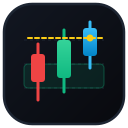

<p align="center">
  
</p>

<h1 align="center">TraderChart Studio</h1>

<p align="center">
  Engine charting visual &amp; diagram SVG open-source untuk membuat dokumentasi trading, playbook SMC/ICT, dan panduan analisis teknikal.
</p>

<p align="center">
  <a href="./README.md">English</a> •
  <strong>Bahasa Indonesia</strong> •
  <a href="./README.zh-CN.md">简体中文</a>
</p>

---

Dibangun menggunakan **React**, **TypeScript**, **Tailwind CSS**, **SVG**, dan **TradingView Lightweight Charts v5**.

## Fitur Utama

### 1. Custom SVG Chart Builder & Renderer
- **Visual Studio (`CustomChartBuilderModal`, `ChartCanvas`, `CandleTemplateTray`)**: Editor interaktif untuk menyusun candlestick, garis struktur pasar, zona, dan anotasi lengkap dengan mode Dark/Light.
- **Renderer JSON Deklaratif (`CustomChartRenderer`)**: Render diagram trading SVG yang tajam, mendukung zoom & pan langsung dari objek JSON `CustomChartConfig`.
- **Primitif Trading Lengkap**:
  - **Candlestick & Indikator**: Lilin OHLC dengan warna/label kustom, histogram volume opsional, dan overlay EMA.
  - **Zona (`BoxDrawing`)**: Order Block (`order_block`), Fair Value Gap (`fvg`), Supply/Demand (`supply_demand`), dan Liquidity Pool (`liquidity_pool`) dengan garis tengah 50% Mean Threshold / Consequent Encroachment.
  - **Fibonacci Retracement (`FibonacciDrawing`)**: Level kustom dan arsiran zona Golden Pocket OTE (Optimal Trade Entry).
  - **Posisi Risk/Reward (`PositionDrawing`)**: Kotak entry/SL/TP Long & Short lengkap dengan badge rasio R:R otomatis.
  - **Struktur & Alur**: `TrendlineDrawing` (BOS / CHoCH dengan ray & panah), `PolylineDrawing` (gelombang `zigzag` atau `smooth`), dan `ArrowDrawing` (panah lurus atau melengkung).
  - **Kartu Edukasi**: `InfoCardDrawing` (kartu fase multi-baris dengan step badge) dan `TextBadgeAnnotation` (`pill`, `badge`, `outline`, `callout`).
- **Ekspor Sekali Klik**: Salin JSON `CustomChartConfig` atau ekspor hasil chart langsung menjadi file `.svg` untuk Markdown, Notion, GitHub, maupun dokumentasi web.

### 2. Chart Pasar Interaktif (`InteractiveTradingChart`)
- Ditenagai oleh **TradingView `lightweight-charts` v5** (`CandlestickSeries`, `HistogramSeries`).
- Mendukung crosshair interaktif, marker (`arrowUp`, `arrowDown`, `circle`, `square`), garis level harga kunci, dan overlay kotak zona.

### 3. Katalog Diagram Teknikal Preset (`PresetSvgCatalog` & `VisualDiagram`)
- Koleksi diagram vektor siap pakai yang mencakup konsep inti trading (Anatomi Candlestick, Market Structure, BOS/CHoCH, Strong/Weak Levels, Supply & Demand, Order Block, dan lainnya).

### 4. Penampil & Anotator Snapshot (`ChartSnapshotViewer`)
- Tampilkan dan beri anotasi pada screenshot chart eksternal atau URL snapshot TradingView (`https://www.tradingview.com/x/...` otomatis dikonversi ke URL gambar langsung) dengan fitur zoom dan lightbox.

### 5. Unified Illustration Engine (`UnifiedIllustrationEngine`)
- Komponen terpadu yang menggabungkan mode `preset`, `interactive_chart`, dan `snapshot` dalam satu antarmuka switch mode.

---

## Mulai Cepat

### Prasyarat
- [Bun](https://bun.sh/) (direkomendasikan) atau Node.js 18+

### Instalasi & Pengembangan

```bash
# Pasang dependensi
bun install

# Jalankan TraderChart Studio
bun run dev
```

Buka `http://localhost:3000` di browser untuk mengakses **TraderChart Studio**.

### Build Produksi

```bash
bun run build
bun run preview
```

---

## Struktur Proyek

```text
public/
└── logo.svg                                      # Logo vektor proyek
src/
├── App.tsx                                       # Aplikasi TraderChart Studio mandiri
├── types/
│   └── chartBuilderTypes.ts                      # Tipe CustomChartConfig & primitif gambar
├── data/
│   └── sampleCharts.ts                           # Preset JSON SMC & FVG bawaan
└── components/
    ├── VisualDiagram.tsx                         # Pustaka diagram SVG trading preset
    ├── chart-builder/
    │   ├── CustomChartBuilderModal.tsx           # Modal editor chart visual interaktif
    │   ├── ChartCanvas.tsx                       # Kanvas editing SVG interaktif
    │   └── CandleTemplateTray.tsx                # Tray template candlestick & skenario
    └── illustration/
        ├── CustomChartRenderer.tsx               # Renderer chart SVG deklaratif
        ├── InteractiveTradingChart.tsx           # Wrapper Lightweight Charts v5
        ├── ChartSnapshotViewer.tsx               # Penampil & anotator snapshot
        ├── PresetSvgCatalog.tsx                  # Katalog diagram preset dengan pencarian
        └── UnifiedIllustrationEngine.tsx         # Wrapper ilustrasi multi-mode
```

---

## Penggunaan Deklaratif (`CustomChartRenderer`)

Sematkan chart ke aplikasi dokumentasi React Anda dengan mengirimkan objek `CustomChartConfig`:

```tsx
import { CustomChartRenderer } from './components/illustration/CustomChartRenderer';
import type { CustomChartConfig } from './types/chartBuilderTypes';

const config: CustomChartConfig = {
  title: 'LIQUIDITY SWEEP & ORDER BLOCK ENTRY',
  subtitle: 'BTC/USDT H1 • Bullish Displacement & 50% Mean Threshold Retest',
  candleSpacing: 'wide',
  showCandles: true,
  showVolume: true,
  candles: [
    { id: 'c0', index: 0, open: 100, high: 104, low: 98, close: 103, volume: 1200, label: 'Konsolidasi' },
    { id: 'c1', index: 1, open: 103, high: 105, low: 93, close: 97, volume: 2800, label: 'Judas Sweep' },
    { id: 'c2', index: 2, open: 97, high: 110, low: 96, close: 108, volume: 3900, label: 'Displacement' },
    { id: 'c3', index: 3, open: 108, high: 116, low: 107, close: 115, volume: 3400, label: 'BOS High' },
    { id: 'c4', index: 4, open: 115, high: 116, low: 103, close: 105, volume: 1400, label: 'Retest OB' },
    { id: 'c5', index: 5, open: 105, high: 125, low: 104, close: 123, volume: 4200, label: 'Ekspansi TP' },
  ],
  boxes: [
    {
      id: 'ob-demand',
      boxType: 'order_block',
      startIndex: 1,
      endIndex: 4,
      topPrice: 103,
      bottomPrice: 94,
      label: 'Bullish Order Block (OB)',
      labelPosition: 'bottom-left',
      color: '#10B981',
      opacity: 0.18,
      showMidLine: true,
      midLineLabel: '50% MT',
    },
  ],
  trendlines: [
    {
      id: 'tl-bos',
      x1Index: 0,
      y1Price: 104,
      x2Index: 3,
      y2Price: 104,
      color: '#10B981',
      strokeWidth: 1.6,
      lineStyle: 'dashed',
      label: 'BOS Valid Body Close',
      labelAlignment: 'center',
      showArrow: true,
    },
  ],
};

export function ExampleDocChart() {
  return <CustomChartRenderer config={config} title={config.title} />;
}
```

---

## Panduan Layout & Anti-Tumpukan (Anti-Clashing)

Saat menulis JSON `CustomChartConfig` secara manual maupun lewat AI agent, ikuti aturan berikut agar chart tetap rapi dan mudah dibaca:

1. **Zonasi Vertikal 3 Lapis**:
   - **Lantai Bawah** (3%–6% di bawah wick terendah): Tempatkan sweep SSL, label demand, dan badge Stop Loss Long.
   - **Lantai Tengah** (rentang body lilin): Khusus untuk candlestick, kotak Order Block / FVG, dan trendline BOS. Jangan menaruh `infoCards` atau `badges` di dalam body lilin.
   - **Lantai Atas** (4%–8% di atas wick tertinggi): Tempatkan sweep BSL, label resistance, dan badge Take Profit.
2. **Jarak Horizontal yang Lega**:
   - Gunakan `candleSpacing: 'wide'` (92px) atau `'ultra-wide'` (120px) saat menggunakan `infoCards` atau `badges` dengan teks panjang.
3. **Penempatan InfoCard**:
   - Tempatkan `infoCards` sisi kanan pada `candleIndex: lastIndex + 1` dengan `alignX: 'left'` agar memanjang ke ruang kosong sebelah kanan tanpa menutupi lilin.
4. **Standar Palet Warna Semantik**:

| Konsep | Kode Hex | Penggunaan |
| :--- | :--- | :--- |
| Bullish / Demand / Order Block | `#10B981` | Zona demand, displacement bullish, target long |
| Bearish / Supply / Liquidity Sweep | `#EF4444` / `#F43F5E` | Zona supply, stop loss, penanda sweep |
| Fair Value Gap (FVG) | `#38BDF8` | Zona ketidakseimbangan harga (imbalance) |
| Liquidity Pools (BSL / SSL) | `#FACC15` / `#F59E0B` | Equal highs/lows, klaster stop ritel |
| Zona Fibonacci OTE | `#8B5CF6` | Golden pocket retracement 61.8% – 78.6% |

---

## Lisensi

Lisensi MIT — lihat [LICENSE](./LICENSE) untuk detail selengkapnya.
