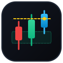

<p align="center">
  
</p>

<h1 align="center">TraderChart Studio</h1>

<p align="center">
  面向交易文档、SMC/ICT 交易手册与技术分析指南的开源可视化图表与 SVG 图解引擎。
</p>

<p align="center">
  <a href="./README.md">English</a> •
  <a href="./README.id.md">Bahasa Indonesia</a> •
  <strong>简体中文</strong>
</p>

---

基于 **React**、**TypeScript**、**Tailwind CSS**、**SVG** 以及 **TradingView Lightweight Charts v5** 构建。

## 核心功能

### 1. 自定义 SVG 图表构建器与渲染器
- **可视化工作室 (`CustomChartBuilderModal`, `ChartCanvas`, `CandleTemplateTray`)**：交互式编辑器，支持放置与自定义 K 线、市场结构线、区域和标注，并支持实时深色/浅色主题切换。
- **声明式 JSON 渲染器 (`CustomChartRenderer`)**：直接通过强类型的 `CustomChartConfig` JSON 对象渲染高清、可缩放、可平移的 SVG 交易图解。
- **丰富的交易绘图原语**：
  - **K 线与指标**：支持自定义颜色/标签的 OHLC K 线、可选成交量柱状图及 EMA 均线叠加。
  - **区域标注 (`BoxDrawing`)**：订单块 (`order_block`)、公允价值缺口 (`fvg`)、供需区 (`supply_demand`) 与流动性池 (`liquidity_pool`)，支持 50% Mean Threshold / Consequent Encroachment 中线。
  - **斐波那契回撤 (`FibonacciDrawing`)**：自定义回撤比例以及 OTE（最佳入场区间）黄金口袋填充区。
  - **盈亏比仓位 (`PositionDrawing`)**：多头与空头入场/止损/止盈框，自动计算并展示 R:R 盈亏比徽章。
  - **结构与趋势流**：`TrendlineDrawing`（带射线与箭头的 BOS / CHoCH）、`PolylineDrawing`（`zigzag` 折线或 `smooth` 平滑波浪）以及 `ArrowDrawing`（直线或弧形箭头）。
  - **教学标注卡片**：`InfoCardDrawing`（带步骤徽章的多行阶段说明卡片）和 `TextBadgeAnnotation`（`pill`、`badge`、`outline`、`callout`）。
- **一键导出**：支持复制 `CustomChartConfig` JSON 或将渲染后的图表直接导出为 `.svg` 文件，方便嵌入 Markdown、Notion、GitHub 或网页文档。

### 2. 交互式行情图表 (`InteractiveTradingChart`)
- 基于 **TradingView `lightweight-charts` v5**（`CandlestickSeries`、`HistogramSeries`）驱动。
- 支持交互式十字光标、交易信号标记（`arrowUp`、`arrowDown`、`circle`、`square`）、水平关键价位线以及价格区间叠加。

### 3. 预设技术图解目录 (`PresetSvgCatalog` & `VisualDiagram`)
- 内置开箱即用的矢量交易图解（K 线结构解析、市场结构、BOS/CHoCH、强弱高低点、供需区、订单块等）。

### 4. 图表截图查看与标注器 (`ChartSnapshotViewer`)
- 支持展示并标注外部图表截图或 TradingView 快照链接（自动将 `https://www.tradingview.com/x/...` 解析为直链图片），支持缩放与灯箱预览。

### 5. 统一图解引擎 (`UnifiedIllustrationEngine`)
- 开箱即用的集成组件，在单一模式切换界面下整合 `preset`、`interactive_chart` 和 `snapshot` 三种模式。

---

## 快速开始

### 环境要求
- [Bun](https://bun.sh/)（推荐）或 Node.js 18+

### 安装与本地开发

```bash
# 安装依赖
bun install

# 启动 TraderChart Studio
bun run dev
```

在浏览器中打开 `http://localhost:3000` 即可使用 **TraderChart Studio**。

### 生产构建

```bash
bun run build
bun run preview
```

---

## 项目结构

```text
public/
└── logo.svg                                      # 项目矢量 Logo
src/
├── App.tsx                                       # 独立的 TraderChart Studio 应用
├── types/
│   └── chartBuilderTypes.ts                      # CustomChartConfig 与绘图原语类型定义
├── data/
│   └── sampleCharts.ts                           # 内置 SMC 与 FVG 示例 JSON 预设
└── components/
    ├── VisualDiagram.tsx                         # 预设 SVG 交易图解库
    ├── chart-builder/
    │   ├── CustomChartBuilderModal.tsx           # 交互式可视化图表编辑器弹窗
    │   ├── ChartCanvas.tsx                       # 交互式 SVG 编辑画布
    │   └── CandleTemplateTray.tsx                # K 线与场景模板托盘
    └── illustration/
        ├── CustomChartRenderer.tsx               # 声明式 SVG 图表渲染器
        ├── InteractiveTradingChart.tsx           # Lightweight Charts v5 封装组件
        ├── ChartSnapshotViewer.tsx               # 截图查看与标注器
        ├── PresetSvgCatalog.tsx                  # 支持搜索的预设图解目录
        └── UnifiedIllustrationEngine.tsx         # 多模式统一图解包装器
```

---

## 声明式用法 (`CustomChartRenderer`)

只需传入一个 `CustomChartConfig` 对象，即可在 React 文档应用中嵌入任意交易图表：

```tsx
import { CustomChartRenderer } from './components/illustration/CustomChartRenderer';
import type { CustomChartConfig } from './types/chartBuilderTypes';

const config: CustomChartConfig = {
  title: 'LIQUIDITY SWEEP & ORDER BLOCK ENTRY',
  subtitle: 'BTC/USDT H1 • 看涨位移与 50% Mean Threshold 回踩',
  candleSpacing: 'wide',
  showCandles: true,
  showVolume: true,
  candles: [
    { id: 'c0', index: 0, open: 100, high: 104, low: 98, close: 103, volume: 1200, label: '盘整' },
    { id: 'c1', index: 1, open: 103, high: 105, low: 93, close: 97, volume: 2800, label: '流动性扫荡' },
    { id: 'c2', index: 2, open: 97, high: 110, low: 96, close: 108, volume: 3900, label: '强势位移' },
    { id: 'c3', index: 3, open: 108, high: 116, low: 107, close: 115, volume: 3400, label: 'BOS 高点' },
    { id: 'c4', index: 4, open: 115, high: 116, low: 103, close: 105, volume: 1400, label: 'OB 回踩' },
    { id: 'c5', index: 5, open: 105, high: 125, low: 104, close: 123, volume: 4200, label: '扩张止盈' },
  ],
  boxes: [
    {
      id: 'ob-demand',
      boxType: 'order_block',
      startIndex: 1,
      endIndex: 4,
      topPrice: 103,
      bottomPrice: 94,
      label: '看涨订单块 (OB)',
      labelPosition: 'bottom-left',
      color: '#10B981',
      opacity: 0.18,
      showMidLine: true,
      midLineLabel: '50% MT',
    },
  ],
  trendlines: [
    {
      id: 'tl-bos',
      x1Index: 0,
      y1Price: 104,
      x2Index: 3,
      y2Price: 104,
      color: '#10B981',
      strokeWidth: 1.6,
      lineStyle: 'dashed',
      label: 'BOS 实体收盘确认',
      labelAlignment: 'center',
      showArrow: true,
    },
  ],
};

export function ExampleDocChart() {
  return <CustomChartRenderer config={config} title={config.title} />;
}
```

---

## 布局与防重叠规范

手动编写或通过 AI 生成 `CustomChartConfig` JSON 时，建议遵循以下规则以保持图表整洁易读：

1. **三层垂直分区**：
   - **底层**（低于最低影线 3%–6%）：放置 SSL 扫荡标注、需求区标签与多头止损徽章。
   - **中层**（K 线实体区间）：仅用于放置 K 线、订单块 / FVG 矩形框与 BOS 趋势线，切勿将 `infoCards` 或 `badges` 放在 K 线实体内部。
   - **顶层**（高于最高影线 4%–8%）：放置 BSL 扫荡标注、阻力标签与止盈徽章。
2. **充裕的水平间距**：
   - 当包含 `infoCards` 或较长文字的 `badges` 时，使用 `candleSpacing: 'wide'`（92px 步进）或 `'ultra-wide'`（120px 步进）。
3. **InfoCard 锚点定位**：
   - 右侧说明卡片建议放在 `candleIndex: lastIndex + 1` 并设置 `alignX: 'left'`，使其向右延伸至空白区域，避免遮挡左侧 K 线。
4. **标准语义配色**：

| 概念 | 十六进制色值 | 用途 |
| :--- | :--- | :--- |
| 看涨 / 需求区 / 订单块 | `#10B981` | 需求区、看涨位移、多头目标 |
| 看跌 / 供给区 / 流动性扫荡 | `#EF4444` / `#F43F5E` | 供给区、止损位、扫荡提示 |
| 公允价值缺口 (FVG) | `#38BDF8` | 价格失衡 / 缺口区域 |
| 流动性池 (BSL / SSL) | `#FACC15` / `#F59E0B` | 等高/等低点、散户止损密集区 |
| 斐波那契 OTE 区间 | `#8B5CF6` | 61.8% – 78.6% 黄金回撤口袋 |

---

## 开源协议

MIT License — 详见 [LICENSE](./LICENSE)。
